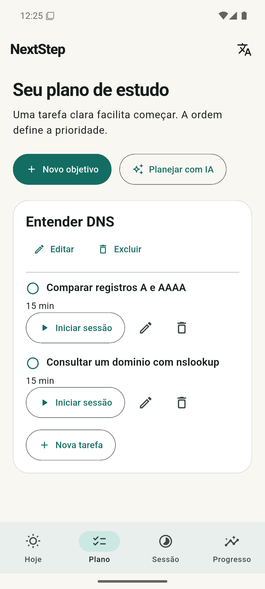
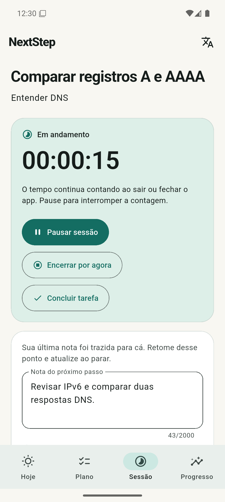
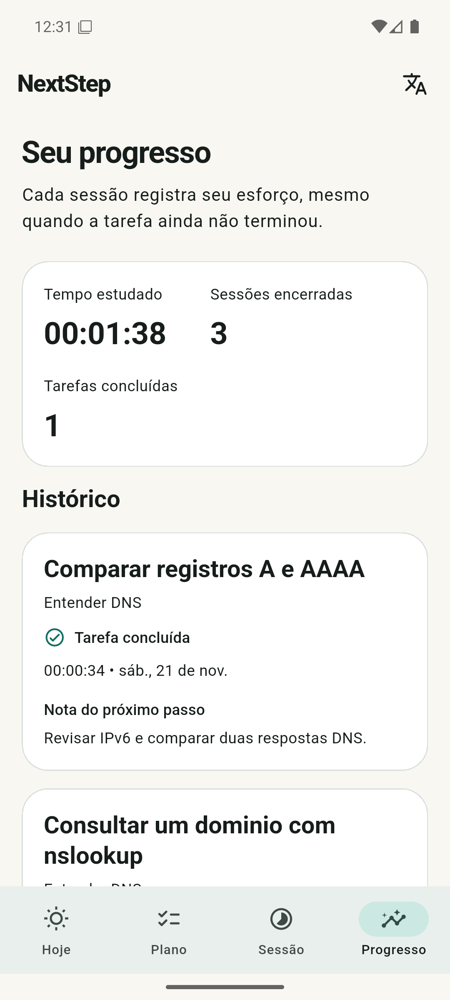

# NextStep

## Problem

Starting a study session is easier when the next action is clear. NextStep turns
goals into small tasks and keeps the next-step note available after an interruption.
Version **0.3.0** runs on Android and stores plans and sessions locally, without an account.

## Delivered features

- Create, edit and organize goals and tasks with time estimates and optional reference links.
- Choose available minutes and find an unfinished task that fits.
- **Pause/resume** the same session, **finish for now** while keeping the task pending,
  or explicitly **complete the task**.
- Start another session with a fresh timer and the previous next-step note.
- Review recorded time, notes, finished sessions and completed tasks in Progress.
- Use Portuguese or English, with local SQLite persistence and automatic note saving.

A running session keeps counting when the app closes; pause to stop its clock.
Optional **Firebase/Gemini** planning is prepared but not activated or validated
against the live service. Unconfigured builds explain this before the request
form. Saved proposals remain reviewable offline and require confirmation before import.
[AI setup](docs/AI_SETUP.md).

## Screenshots and demo

Signed-release captures from an Android API 36 emulator, using example study data:

<p>
  
  
  
</p>

[Download the 2:30 demo](https://github.com/Tyago03/NextStep/releases/download/v0.3.0/NextStep-0.3.0-demo.mp4)
with English captions and identified cuts. GitHub sign-in and access to the
private repository are required. [Presentation details](docs/PORTFOLIO.md).

## APK installation

[Download the signed APK](https://github.com/Tyago03/NextStep/releases/download/v0.3.0/NextStep-0.3.0-release.apk)
(52.6 MiB) from [Release v0.3.0](https://github.com/Tyago03/NextStep/releases/tag/v0.3.0).
The release currently requires access to the private repository.
The maintainer reported successful manual testing on his Android phone on
**21 November 2026**. Device details and per-case measurements have not yet been
recorded; see [the device test record](docs/DEVICE_TEST.md).

Requires **Android 7.0/API 24 or later**. Open the APK and approve installation
for the app opening the file. Release and debug signatures differ; preserve
existing debug data rather than uninstalling to bypass a conflict.
ARM64, ARMv7 and x86_64 libraries are included. Check the
[SHA-256](https://github.com/Tyago03/NextStep/releases/download/v0.3.0/NextStep-0.3.0-release.apk.sha256)
and [distribution details](docs/DISTRIBUTION.md). There is no Play Store listing.

## Run from source

Prerequisites: **Flutter 3.50.0/Dart 3.14**, JDK 21, Android SDK 36 and an authorized
Android device or emulator. Add Flutter to `PATH`. Manual planning needs no Firebase
configuration. Repository access is currently required to clone:

```sh
git clone https://github.com/Tyago03/NextStep.git
cd NextStep
flutter pub get --enforce-lockfile
flutter devices
flutter run -d DEVICE_ID
```

Replace `DEVICE_ID` with the Android ID listed above. For a local debug APK:

```sh
flutter build apk --debug -t lib/main.dart
```

## Tests and limits

```sh
dart format --output=none --set-exit-if-changed lib test integration_test
flutter analyze
flutter test --reporter expanded
```

The verified 0.3.0 checkpoint passed **92 host tests** and **four Android integration
stages**, including process restart. [Validation record](docs/VALIDATION.md).
The maintainer's phone acceptance is a separate manual report, not a multi-device
compatibility or accessibility certification. TalkBack, live Gemini, iOS, web and
Windows desktop remain unvalidated. No backup, export or synchronization is included;
uninstalling or clearing data can erase records. Edits still marked as saving may
be lost if the process is forcibly stopped.

## Author

Author and maintainer: Tyago Vitorino Ferreira
