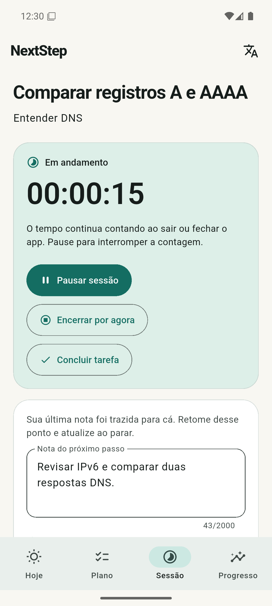

# NextStep — project overview

NextStep helps turn a study goal into a small action and preserve the next step
after an interruption. Plans, notes and sessions stay on the Android device,
without an account. Pausing preserves an open session; finishing for now keeps
the task available for another session. Completing the task is a separate choice.

## Demonstration

Version **0.3.0** was demonstrated on a dedicated Android API 36 emulator using
synthetic DNS study data. The demonstration covers creating two tasks, pausing,
recovering the note after process restart, alternating tasks, starting a fresh
session with the previous note and completing a task. Progress shows three
finished sessions, one completed task and the recorded total time.

The demo also shows the initial availability notice for Firebase/Gemini planning.
Live generation is not activated or verified. Existing proposals can still be
reviewed and imported locally after confirmation.

| Manual plan | New session with previous note | Progress |
| --- | --- | --- |
|  |  |  |

These are captures of the installed release, not mockups. Example data does not
represent actual study habits or measured outcomes.

## Artifacts and availability

| Artifact | Details |
| --- | --- |
| [Signed Android release](https://github.com/Tyago03/NextStep/releases/download/v0.3.0/NextStep-0.3.0-release.apk) | 55,127,375 bytes; signature checked and installed on the emulator. |
| [Demonstration video](https://github.com/Tyago03/NextStep/releases/download/v0.3.0/NextStep-0.3.0-demo.mp4) | 2:30, 3,450,160 bytes; English captions, no audio. |
| [Real screenshots](images/) | Captures of the installed release with example data. |

The APK and video are available as assets of
[Release v0.3.0](https://github.com/Tyago03/NextStep/releases/tag/v0.3.0).
Source code and release assets are public and available without sign-in.
There is no store listing. The release also includes the
[APK checksum](https://github.com/Tyago03/NextStep/releases/download/v0.3.0/NextStep-0.3.0-release.apk.sha256)
and [verification record](https://github.com/Tyago03/NextStep/releases/download/v0.3.0/VERIFICATION.json).

The video identifies cuts and its final held frame. Retained footage runs at
normal speed; captured notes and timer values are unchanged. Reopening after
process termination recovered the same paused time and note. This is emulator
evidence, not a physical-phone test.

## Technical scope

Flutter, Riverpod and SQLite provide the interface, application state and local
persistence. Transactions preserve notes and elapsed time during session changes;
schema migrations retain earlier records. The verified checkpoint passed 92 host
tests and four Android integration stages. On 21 November 2026, the maintainer
reported successful manual testing on an Android phone. Device metadata and
per-case measurements remain to be recorded in [the device test record](DEVICE_TEST.md).
TalkBack, multi-device compatibility and live Gemini remain unvalidated.
Backup/export is not implemented.

## Author

Author and maintainer: Tyago Vitorino Ferreira
