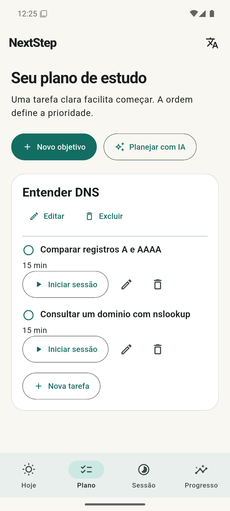
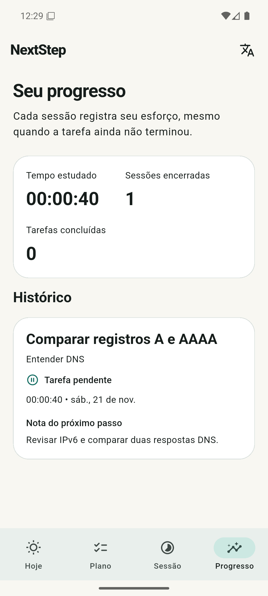
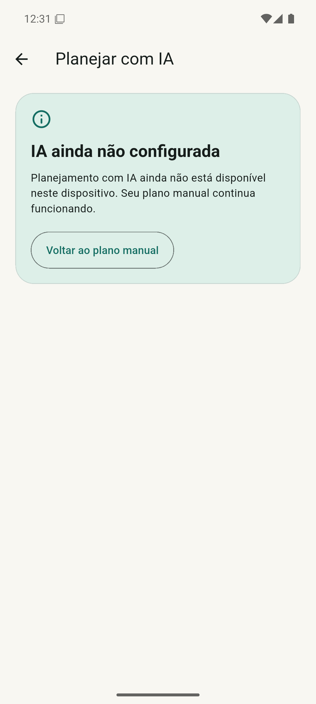

# Apresentação do NextStep

## Objetivo e estado de publicação

Demonstrar um problema concreto: começar a estudar e recuperar o contexto depois
de uma interrupção. O escopo apresentado é planejamento manual e sessões locais
no Android. A IA é opcional e sua integração real ainda não foi ativada.

O repositório continua privado. Preparar arquivos localmente não os torna
acessíveis a um recrutador. A publicação de vídeo, código ou APK depende de
aprovação específica de Tyago; não foi autorizada por esta revisão.

A [vaga da Symmetry](https://symmetry.club/en/careers/jr-mobile-engineer), consultada
em 20/11/2026, pede um trabalho acessível sem solicitar autorização. Um link
público de demonstração pode cumprir a apresentação do trabalho sem mudar a
visibilidade de todo o repositório. O resultado precisa ser conferido sem login
depois de uma eventual publicação.

## Demonstração real preparada

Gravação em 21/11/2026 da instalação release 0.3.0 no emulador dedicado
`NextStep_Demo_API36` (Android API 36), sem alterar os dados da instalação debug.
Todos os dados são exemplos sintéticos; não representam sessões reais de estudo
ou resultados de Tyago. As imagens abaixo são capturas do aplicativo instalado.

O fluxo gravado contém:

1. Criar o objetivo **Entender DNS** em um plano vazio.
2. Criar **Comparar registros A e AAAA** e **Consultar um dominio com nslookup**.
3. Iniciar a primeira tarefa e escrever uma nota de próximo passo.
4. Pausar, sair do aplicativo e reabrir. Conferir o mesmo tempo pausado e a nota.
5. Retomar e selecionar **Encerrar por agora**. Mostrar a tarefa ainda pendente
   e a sessão registrada no histórico.
6. Iniciar a outra tarefa, encerrá-la e voltar à primeira em uma nova sessão.
7. Mostrar a nota anterior e o novo cronômetro; então **Concluir tarefa**.
8. Mostrar três sessões encerradas, uma tarefa concluída e o tempo total.
9. Abrir a IA sem configuração, ver o aviso antes do formulário e voltar ao plano
   manual, sem login e sem gerar uma resposta fictícia.

O vídeo editado fica em `dist/demo/NextStep-0.3.0-demo.mp4`, fora do Git. As
gravações originais e o registro de edição ficam na mesma pasta. O vídeo indica
os cortes e o uso de dados de exemplo; não modifica os valores do cronômetro.
Duração: **2min30s**; tamanho: **3.450.160 bytes**; H.264, 720×1920, 30 fps,
sem áudio, com legendas explicativas em inglês e nove capítulos. A imagem do
app é preservada integralmente; as legendas ficam fora dela. Os trechos mantidos
rodam em velocidade normal, e o último quadro real é mantido por dois segundos
com aviso explícito. Decodificação completa e inspeção visual aprovadas.
SHA-256: `e6794fa06bf9c683cdfc6bce37a80fc97a6abca219280a2a6301f5198325f71b`.

O início do Android ficou vazio ao fechar o app pelos recentes; a reabertura
foi feita após `force-stop` e lançamento pelo terminal de desenvolvimento.
O app reabriu com a mesma nota e os mesmos 18 segundos pausados. Isso é evidência
de recuperação de processo no emulador, não de funcionamento em celular físico.

| Plano manual | Sessão encerrada, tarefa pendente | IA indisponível antes do pedido |
| --- | --- | --- |
|  |  |  |

## Explicação curta em inglês

> NextStep helps me turn a study goal into a small action and keep the next step
> visible after an interruption. Plans and sessions stay on the device, without
> an account. Pausing preserves an open session; ending for now keeps the task
> available for another session. Completing the task is a separate decision.

Tyago definiu o problema pessoal, o escopo, as prioridades e as revisões do
produto. Codex auxiliou na implementação, nos testes, na documentação e na
revisão de código. Não atribuir a Tyago implementação manual não demonstrada
nem omitir a assistência de IA.

Pontos para explicar com o código aberto:

- A interface chama o controlador; as regras e gravações ficam no repositório.
- O tempo vem de timestamps persistidos, sem depender de um contador em segundo
  plano. Pausar congela o intervalo; reiniciar a tarefa cria uma sessão nova.
- Encerramento e conclusão são transações; comandos repetidos não somam tempo
  duas vezes. Migrações preservam o histórico existente.
- SQLite foi escolhido pela persistência local e transações, sem login ou nuvem.
- Uma proposta da IA é um rascunho até a confirmação; testes com fixtures não
  provam que o Gemini real foi ativado.

## Revisão antes de compartilhar

Revisar os arquivos concretos a publicar, incluindo histórico quando houver
código. Excluir chaves de assinatura, credenciais, bancos e dados pessoais.
Conferir autoria e licenças dos recursos e dependências distribuídos. Manter
claros os limites: sem publicação em loja, sem validação física/TalkBack enquanto
não executadas, sem alegação de uso real baseada em dados de demonstração.

O artefato local `dist/NextStep-0.3.0-release.apk` tem assinatura própria verificada,
foi instalado e usado na demonstração. Tamanho: **55.127.375 bytes** (52,6 MiB).
O checkpoint registra o SHA-256, o certificado e os limites da validação. Não é
uma publicação em loja nem um download público. Preservar o par chave/configuração
privada para permitir atualizações futuras com a mesma assinatura.

## Próxima entrega proposta

Após esta revisão, priorizar **exportação e restauração local**: formato versionado,
validação de tamanho/esquema/consistência, confirmação antes de restaurar e
rollback que preserve o banco se houver falha. Essa entrega não faz parte da
implementação desta rodada e não exige login ou sincronização.
